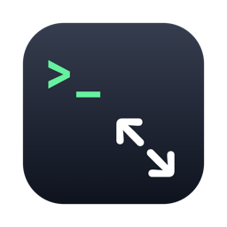
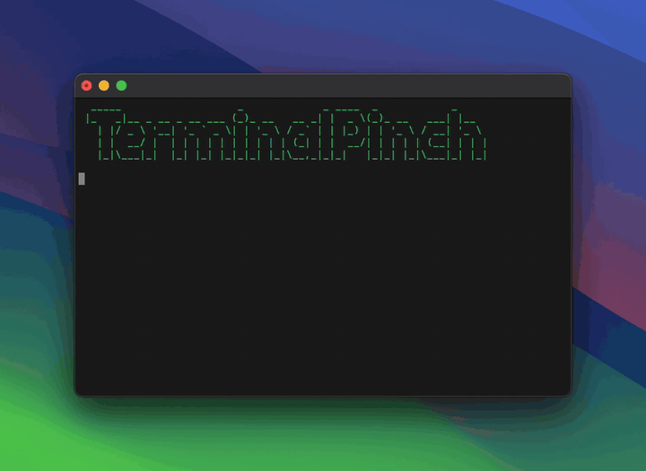
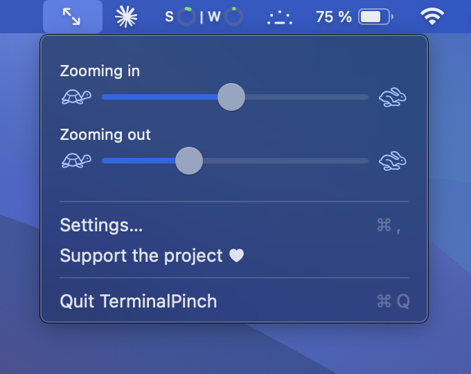
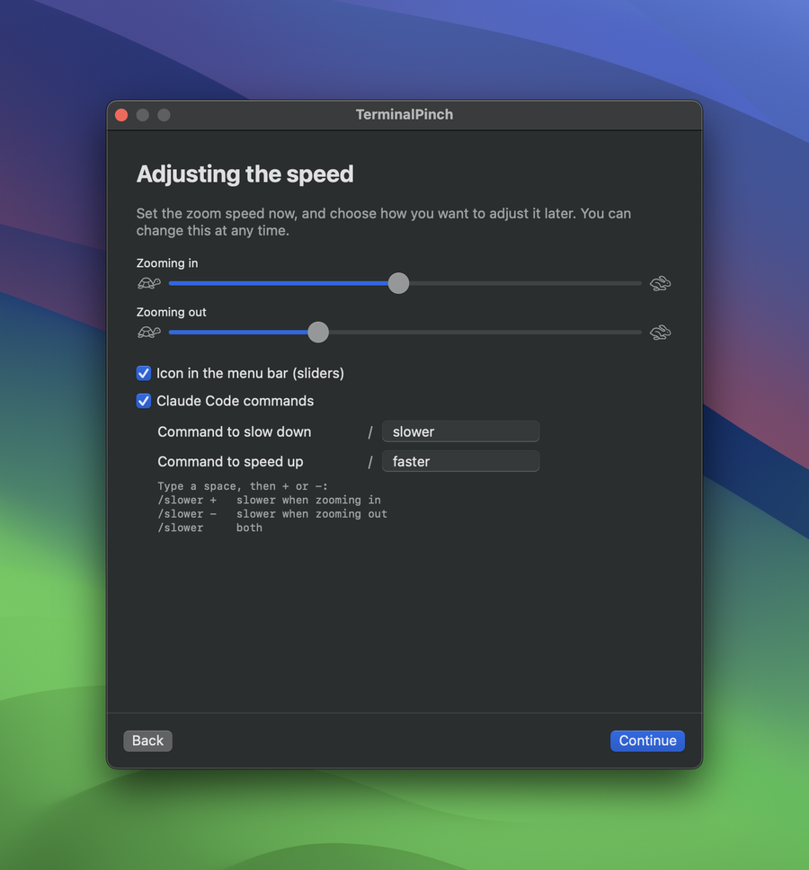

# TerminalPinch

**Pinch to zoom in your Mac terminal — change the font size with two fingers on the trackpad, without resizing the window.**

A tiny free menu bar app for macOS. Works with Terminal, iTerm2, Ghostty, Warp, kitty and WezTerm.



[Français](README.fr.md)

Pinch with two fingers on your trackpad to make the text bigger or smaller, just like in a browser. Unlike `⌘ +` / `⌘ -`, the window keeps its size.

- Tested with **Terminal**, **iTerm2**, **Ghostty**, **Warp**, **kitty** and **WezTerm** (should also work with Alacritty, Hyper and Tabby — not tested yet)
- Separate speeds for zooming in and zooming out
- Adjust the speed from a **menu bar icon** or with **Claude Code commands** (`/slower -`, `/faster +`…)
- Available in English, French, Spanish, Italian, German, Portuguese, Chinese and Japanese (follows your Mac's language)
- Free and open source

<p align="center"> </p>

## Install

**In one line** (recommended — no Gatekeeper warning):

```sh
curl -fsSL https://raw.githubusercontent.com/Throover/TerminalPinch/main/install.sh | sh
```

**Or manually:**

1. Download `TerminalPinch-x.y.z.dmg` from the [latest release](../../releases/latest).
2. Open it and drag **TerminalPinch** into **Applications**.
3. Open TerminalPinch. The first time, macOS may say the app is from an unidentified developer (the app isn't notarized by Apple — that costs $99/year):
   - **macOS 13–14:** right-click the app → **Open** → **Open**.
   - **macOS 15+:** try to open it once, then go to **System Settings → Privacy & Security** and click **Open Anyway**.
4. Follow the short setup: it asks for the one permission it needs and lets you choose how to adjust the speed.

Requires macOS 13 Ventura or later, on Apple Silicon or Intel.

## Permissions

| Permission | Why |
|---|---|
| Accessibility | to detect the pinch, change the text size in iTerm2, Ghostty, etc. and put the window back to its size |
| Automation → Terminal | Apple's Terminal only: to change the font size directly (asked the first time you pinch) |

TerminalPinch only listens to pinch gestures. It never reads what you type, and it has no network access.

## Claude Code commands

If you use [Claude Code](https://claude.com/claude-code), the setup can install two commands, named in your language (you can rename them):

| Command | Effect |
|---|---|
| `/slower +` | slower when zooming in |
| `/slower -` | slower when zooming out |
| `/slower` | both |
| `/faster +`, `/faster -`, `/faster` | same, faster |

The same works from any shell: `/Applications/TerminalPinch.app/Contents/MacOS/TerminalPinch --adjust slower -`

## How it works

- Apple's **Terminal**: the font size is changed with AppleScript, then the window bounds are restored.
- **Other terminals**: TerminalPinch sends `⌘ =` / `⌘ -` (found on your keyboard layout, so AZERTY and QWERTZ work), then restores the window frame through the Accessibility API.

If a terminal already handles pinch-to-zoom on its own, turn it off in **Settings → Terminals**.

## FAQ

**How do I zoom in the Mac terminal without resizing the window?**
By default, `⌘ +` in Terminal makes the text bigger *and* the window bigger. TerminalPinch changes only the font size and keeps the window exactly where and how big it was.

**Can I pinch to zoom in iTerm2, Ghostty, Warp, kitty or WezTerm?**
Yes. TerminalPinch adds pinch-to-zoom to all of them, with the same behavior.

**Does it slow down my Mac or read my keystrokes?**
No. It only listens to trackpad pinch gestures, uses almost no CPU, and has no network access.

## Uninstall

Quit TerminalPinch from its menu, delete it from Applications, then optionally run `tccutil reset All app.terminalpinch` to remove its permission.

## Build from source

```sh
git clone https://github.com/Throover/TerminalPinch.git
cd TerminalPinch
./scripts/build.sh      # → build/TerminalPinch.app and build/TerminalPinch-x.y.z.dmg
```

Only the Xcode Command Line Tools are needed (`xcode-select --install`).

## Support

TerminalPinch is free. If it's useful to you, you can support it:

[](https://ko-fi.com/throover)
[](https://liberapay.com/Throover)

- **Ko-fi** — one-time or monthly
- **Liberapay** — recurring, run by a non-profit

## License

MIT
